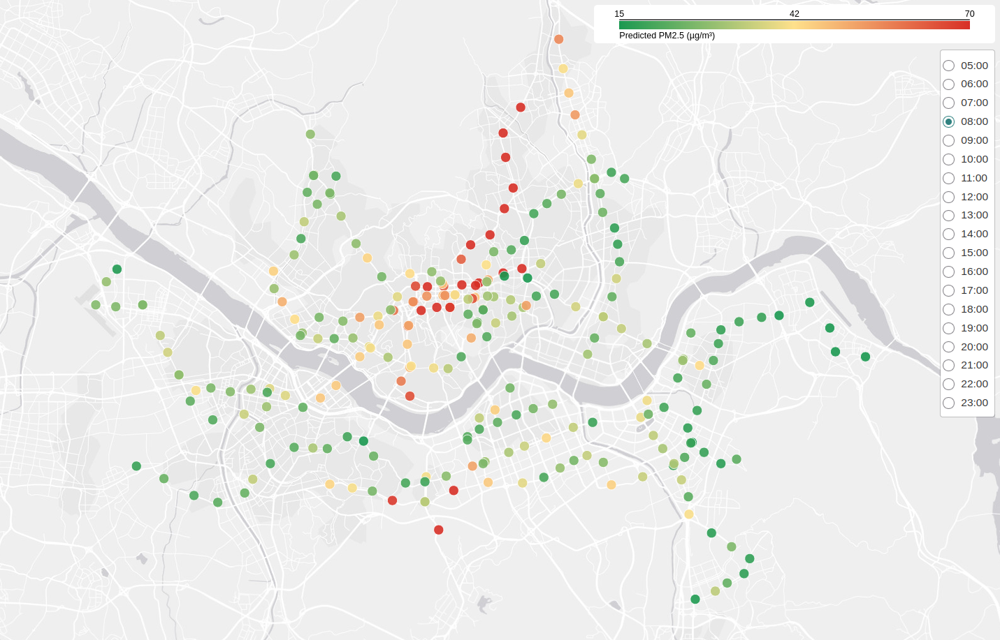

# PM2.5 in metro stations

Fine particles (PM2.5) are often much more concentrated underground than in the street, and measuring them in every station at every hour is a lot of work. This project trains a model on PM2.5 measurements and on what is known about each station, and uses it to estimate the typical PM2.5 level of every station of a metro network, hour by hour.

[Open the interactive map](https://glofmar.github.io/pm25-metro-prediction/map.html) to choose the hour and see the value of each station.



## Background

The code was developed for a project on PM2.5 in the Paris metro. The question was whether measurements made with a portable sensor, combined with what is known about each station (depth, number of lines and exits, platform layout and so on), could give an estimate of PM2.5 levels across the whole network, including the stations that were never visited.

This repository runs the same code on open data from the Seoul metro (lines 1 to 8), where Seoul Metro publishes hourly readings from monitors installed in its stations, so that anyone can run it. Nothing in the code is specific to Seoul: any network can be used as long as it provides the same two files, a list of PM2.5 measurements and a table of station characteristics.

## Results

The model is a random forest that uses the characteristics of the station, its line and the hour. The Seoul monitors measure every station at every hour, which no field campaign does, so we report results for simulated campaigns in which only some stations are visited, a few times each. With half of the stations visited three times (about 380 measurements), the model is off by 6.1 µg/m³ on average at the hours that were not measured in visited stations, and by 10.2 µg/m³ in stations that were never visited. Always predicting the mean of the measurements would give 13.7 µg/m³.

For stations that were never visited, measuring more stations helps much more than going back to the same ones. See [docs/results.md](docs/results.md) for the details and [docs/methodology.md](docs/methodology.md) for how the model is evaluated.

## How it works

The code reads two files in `data/raw/`: the measurements and the station table. Both are included, and [data/README.md](data/README.md) describes their format and where they come from. Four scripts then do the work:

| Script | What it does | Output |
|---|---|---|
| `scripts/1_evaluate.py` | cross-validates the model | `results/evaluation.csv`, `results/out_of_fold.csv` |
| `scripts/2_train.py` | trains the model on all the measurements | `models/model.joblib` |
| `scripts/3_predict.py` | predicts every underground station from 5:00 to 23:00 | `results/predictions.csv` |
| `scripts/4_make_map.py` | draws the interactive map | `docs/map.html` |

## Running it

```bash
python -m venv .venv
source .venv/bin/activate          # Windows: .venv\Scripts\activate
pip install -r requirements.txt

python scripts/1_evaluate.py       # about 7 minutes
python scripts/2_train.py
python scripts/3_predict.py
python scripts/4_make_map.py
```

A trained model is already in `models/`, so the last two scripts can be run straight away. The notebook [results.ipynb](results.ipynb) shows the scores and the map.

## Repository layout

```
data/      measurements, station table, and how they were built
pm25/      the code: data loading, features, model, validation, map
scripts/   the four steps above
models/    the trained model
docs/      methodology, results and map
```

## Data

The data comes from Seoul Metro (서울교통공사) through the [Seoul Open Data Plaza](https://data.seoul.go.kr). It is used under the [Korea Open Government License type 1](https://www.kogl.or.kr/info/licenseType1.do) and was modified for this project (filtered, aggregated and renamed); [data/README.md](data/README.md) lists the datasets and the changes.

Parts of the code and documentation were written with the help of an AI coding agent. All results were checked by running the code on real data.

## Licence

The code is under the [MIT License](LICENSE). The data in `data/` is not covered by this licence: it comes from Seoul Metro under the Korea Open Government License type 1.
