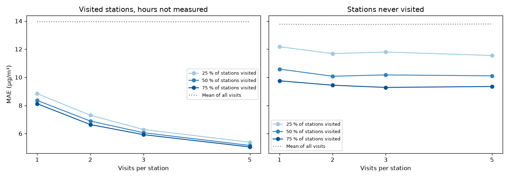

# Results: the Seoul example

The Seoul monitors measure every station at every hour, which no field campaign does. To get results that say something about a campaign with a portable sensor, we simulate campaigns on the Seoul data (lines 1 to 8, April to December 2021, see [data/README.md](../data/README.md)). A share of the stations is visited, each at a few random hours, and the model only learns from these visits. We then look at two things: how well it fills in the hours that were not measured in the visited stations, and how well it predicts the stations nobody visited.

Each setting is repeated 10 times with different stations and hours. MAE and RMSE are in µg/m³.

## Reference scenario: half of the stations, three visits each

This gives about 380 measurements, roughly the size of a field campaign.

| Tested on | MAE | RMSE | R² | Mean of the station's visits | Mean of all visits |
|---|---|---|---|---|---|
| Visited stations, hours not measured | 6.1 | 9.9 | 0.78 | 8.1 | 14.1 |
| Stations never visited | 10.2 | 16.0 | 0.34 | | 13.7 |

The last two columns give the error of two simple guesses: the mean of the station's own visits, and the mean of all visits.

In a visited station, the model fills in the missing hours with an error of 6 µg/m³. That is better than repeating the mean of the station's visits, because the model combines the level of the station with the daily pattern it learned from the other stations. In a station nobody visited, the error is 10 µg/m³, compared with 14 µg/m³ for the mean of all visits.

## How many stations, how many visits?

MAE in the visited stations, at the hours that were not measured:

| Visits per station | 25 % of stations | 50 % | 75 % |
|---|---|---|---|
| 1 | 8.8 | 8.4 | 8.1 |
| 2 | 7.3 | 6.9 | 6.6 |
| 3 | 6.3 | 6.1 | 5.9 |
| 5 | 5.4 | 5.2 | 5.1 |

MAE in the stations never visited:

| Visits per station | 25 % of stations | 50 % | 75 % |
|---|---|---|---|
| 1 | 12.2 | 10.6 | 9.8 |
| 2 | 11.7 | 10.1 | 9.4 |
| 3 | 11.8 | 10.2 | 9.3 |
| 5 | 11.6 | 10.1 | 9.4 |

In the visited stations, the number of visits is what counts: every extra visit lowers the error, whatever the share of stations. For the stations nobody visited, it is the number of stations that counts. Going from 25 % to 75 % of the stations brings the error down from about 11.7 to 9.3 µg/m³, while more than two visits per station make almost no difference. If the goal is a map of the whole network, it is better to spread the visits over many stations than to go back to the same ones.

## Where the model goes wrong

These numbers are for the stations never visited, in the reference scenario. Each measurement's prediction is averaged over the repeats in which its station was not visited.

| Measured PM2.5 | Values | Mean error (predicted − measured) |
|---|---|---|
| up to 20 | 1,002 | +8.1 |
| 20 to 30 | 1,477 | +6.5 |
| 30 to 40 | 1,012 | +1.1 |
| 40 to 60 | 899 | −7.4 |
| above 60 | 360 | −20.2 |

The predictions are pulled towards the average, so low levels come out too high and high levels too low. Lines 1 and 4 are much more polluted than the others (72 and 62 µg/m³ on average, against 26 to 33 elsewhere) and have the largest errors, with an MAE of 21.8 and 20.0 against 7 to 9 on the other lines.

## Other models

Reference scenario, same features.

| Model | MAE, visited stations | MAE, stations never visited |
|---|---|---|
| Random forest (used) | 6.1 | 10.2 |
| XGBoost | 5.8 | 10.2 |
| Histogram gradient boosting | 5.9 | 10.7 |
| Extra trees | 6.2 | 9.9 |
| KNN (k = 10) | 9.6 | 10.7 |
| Ridge | 10.8 | 11.5 |
| Linear regression | 10.8 | 11.5 |
| Mean of the visits | 14.1 | 13.7 |

Models based on trees do best and are close to each other. Trying another one only means changing one line in `pm25/model.py`.

## Which features matter: the example of train frequency and hour of the day

Reference scenario, adding the number of trains per hour, counted from the timetable.

| Features | MAE, visited stations | MAE, stations never visited |
|---|---|---|
| With train frequency | 6.1 | 9.9 |
| Without train frequency (used) | 6.1 | 10.2 |
| Without the hour, with train frequency | 7.0 | 10.6 |
| Without train frequency or hour | 8.0 | 11.7 |

Train frequency and the hour both describe the rhythm of the day. Removing one of them costs little, removing both costs a lot. We left train frequency out to keep the code simple.

## A word on the Seoul data

Each Seoul value is a median over nine months of readings, so a simulated visit is much less noisy than a real measurement of a few minutes. With real campaign data the errors would be larger, and more stations or visits would be needed for the same accuracy. The relative effect of the number of stations and of the number of visits should still hold.
